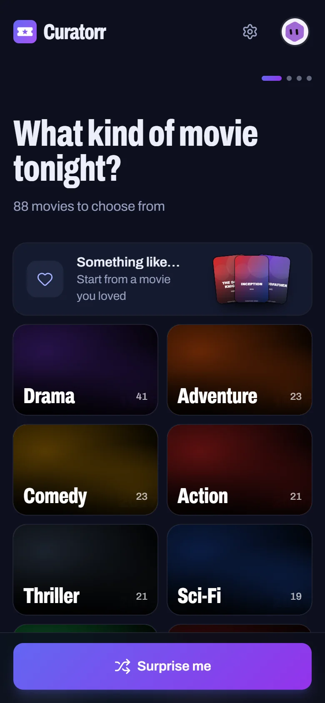
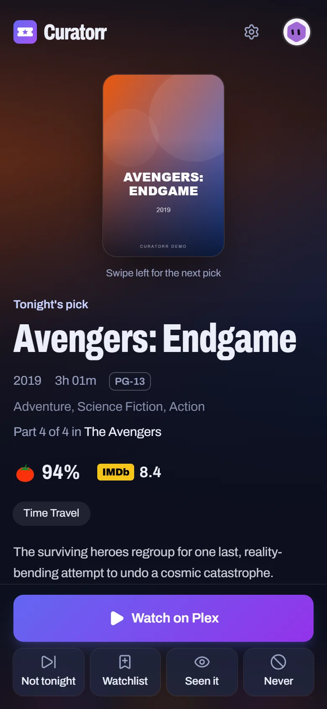
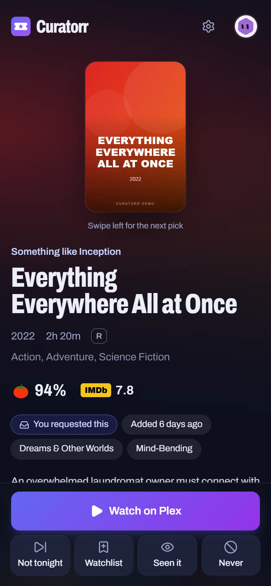

<p align="center"></p>

<h1 align="center">Curatorr</h1>

<p align="center">
  <a href="https://github.com/cosmin-sulita/curatorr/actions/workflows/ci.yml"></a>
  <a href="https://github.com/cosmin-sulita/curatorr/releases/latest"></a>
  <a href="LICENSE"></a>
</p>

<p align="center"><b>What should we watch tonight?</b><br>A few quick questions, then the best movie you already own.</p>

Curatorr asks a few quick questions (genre, theme, mood, how much time you have) and then suggests the best movie *you already own*, using your Radarr library. Picks weigh what critics and audiences thought of each movie with what just arrived and what each person tends to watch. Turn one down and the next is already waiting.

It's a self-hosted, installable PWA built for the *arr stack, with a look borrowed from Seerr.

## Features

- **Radarr is the source of truth.** Only downloaded movies are suggested. Genres, TMDB keywords, ratings, posters and trailers all come from Radarr, so no extra API keys are needed.
- **Plex Home or Jellyfin profiles.** Each person picks their profile and never gets suggestions for movies they already watched in Plex or Jellyfin. Parental restrictions and Plex PINs carry over, and with Jellyfin, so does which libraries each person can open. Jellyfin has no PINs, so a Jellyfin administrator can give a profile one in Curatorr's Settings. Changes made there apply at the next library sync.
- **Watching together.** Tap **Watching together** on Who's watching? and tick two or more people for one pick that none of you has seen. It keeps to everyone's parental limits and blends your tastes, so nobody gets their least favourite. The group lasts the evening.
- **Smart questions.** The wizard only offers answers that match at least three movies in your library and leave some out. It skips questions that wouldn't narrow anything down, and stops asking once a dozen movies or fewer are left, since the picks show them all. Or tap **Surprise me** to skip the questions and get one of the ten best picks, drawn again each evening.
- **Just arrived.** A tile on the first question goes straight to the best of what arrived in your library this past month, each pick saying when it came.
- **In season.** In October a **Halloween** tile goes straight to a spooky pick, movies set on Halloween first. In December a **Christmas** tile does the same for Christmas movies.
- **Something like…** Start from a movie you loved (what you watched lately is listed first, or search the library) and get the unwatched movies that share the most keywords and themes with it.
- **Ranked by critics, audiences and you.** The Rotten Tomatoes critics' score counts as much as the IMDb audience rating, so a crowd-pleaser the critics panned still gets its chance. Movies that just arrived rank higher for a few weeks, and each person's picks lean toward what they watched lately, saying "Because you watched …" when that made the difference.
- **Not tonight / Watchlist / Seen it / Never.** Swipe or tap, and undo any of them. "Not tonight" lowers a movie for two weeks, and longer each time you pass on it again. "Watchlist" saves it and ranks it higher next time; on a pick that's already on your watchlist, the button reads "On watchlist", and tapping it takes the movie off. "Seen it" and "Never" hide it until you restore it in Settings. A pick you're shown but don't play slips a little each evening, so the same few movies don't come back every night.
- **Sagas in order.** A sequel only comes up once its earlier part is watched; until then Curatorr suggests part 1 instead. Once a saga is started, the next part ranks higher. On a long night, "Start a saga" suggests part 1 of the best collections you haven't started. Only parts you own count (a part you marked "Never" doesn't hold back the rest), and big franchises (over 10 films, like James Bond) count as standalone movies.
- **Stays in sync with Plex or Jellyfin.** "Seen it" marks the movie watched for that person, "Watchlist" adds it to their Plex Watchlist or their Jellyfin favourites, and "On watchlist" takes it off there. Undo puts things back. The server owner can turn this off in Settings. Movies on someone's Plex Watchlist or in their Jellyfin favourites, even ones added in another app, rank higher for them, and the ones in the library show on their Watchlist in Settings. While Curatorr updates the server, a movie taken off there leaves Curatorr's watchlist too.
- **Remembers what you asked for.** Connect Seerr during setup or in Settings, and the movies each person requested rank higher for them once downloaded and while still unwatched, labelled "You requested this". Requests are matched to profiles by Plex account or Jellyfin user. The server owner can turn this off in Settings.
- **Watch on Plex** opens the movie's page in the Plex app on phones, where your server is listed as a place to play it. On desktop it goes straight to the movie in Plex Web. **Watch on Jellyfin** opens the movie in Jellyfin's web app, on phones too, since the Jellyfin apps don't open links.

## Screenshots

<p align="center">
  
  
  
</p>

## Requirements

- A Docker host (`linux/amd64` or `linux/arm64`).
- [Radarr](https://radarr.video) v3 or newer. Curatorr only reads from it.
- [Plex Media Server](https://www.plex.tv) or [Jellyfin](https://jellyfin.org) 10.9 or newer, optional but recommended. Either one brings the profiles, watched status, parental restrictions, Watchlist sync and the Watch button. Curatorr uses one of them, chosen during setup.
- [Seerr](https://github.com/seerr-team/seerr), optional, and only together with Plex or Jellyfin.
- HTTPS, through your reverse proxy, to install the app on phones.

## Try the demo

```sh
docker run --rm -p 7979:7979 -e CURATORR_DEMO=1 ghcr.io/cosmin-sulita/curatorr:latest
```

Then open http://localhost:7979. The demo library has about 95 movies and three profiles, needs no Radarr, Plex or Jellyfin, and is gone when you stop the container.

## Install with Docker

1. Create a folder of its own for Curatorr, e.g. `/srv/curatorr`, and run the commands below from inside it. Curatorr keeps its data in that folder.
2. Save [`docker-compose.yml`](docker-compose.yml) there and start it with `docker compose up -d`:

   ```yaml
   services:
     curatorr:
       image: ghcr.io/cosmin-sulita/curatorr:latest
       container_name: curatorr
       restart: unless-stopped
       ports:
         - "7979:7979"
       environment:
         - TZ=Etc/UTC   # your time zone, e.g. Europe/Berlin
         - PUID=1000
         - PGID=1000
       volumes:
         - ./:/config
   ```

   Or with plain Docker:

   ```sh
   docker run -d --name curatorr --restart unless-stopped -p 7979:7979 \
     -e TZ=Etc/UTC -e PUID=1000 -e PGID=1000 \
     -v ./:/config \
     ghcr.io/cosmin-sulita/curatorr:latest
   ```

   Set `PUID`/`PGID` to the user that owns the data folder (run `id` on the host).
3. Open `http://<host-ip>:7979` and follow the setup:
   1. **Radarr**: its address (e.g. `http://192.168.1.10:7878`) and API key (Radarr → Settings → General → Security).
   2. **Plex or Jellyfin**: choose the one you watch with, or skip this step if you use neither.
      - **Plex**: sign in with the account that owns the server, then pick the server and its movie libraries. Plex Home users are imported as profiles.
      - **Jellyfin**: its address (e.g. `http://192.168.1.10:8096`) and an administrator's username and password, then its movie libraries. Every Jellyfin user who isn't disabled becomes a profile. Curatorr keeps a sign-in of its own (listed as Curatorr under Dashboard → Devices), not the password. If people open Jellyfin at a different address from the one Curatorr uses (`https://jellyfin.example.com`, say), enter that too, for Watch on Jellyfin.
   3. **Seerr** (optional, and only with Plex or Jellyfin, since requests are matched to profiles by their account): its address (e.g. `http://192.168.1.10:5055`) and API key (Seerr → Settings → General → API Key).
   4. **Finish**: the library syncs right away, then every 6 hours (configurable).
4. Optional, so new downloads show up within minutes: copy the address under **Settings → New downloads within minutes** in Curatorr. In Radarr, open Settings → Connect, add a **Webhook**, tick **On File Import**, **On Movie Delete** and **On Movie File Delete**, paste the address as its URL, press **Test**, then save. Curatorr's settings then show that Radarr called. If Radarr reaches Curatorr at a different address from your browser, use that one, keeping the part from `/api/radarr/webhook` on.

### Updating

Run `docker compose pull && docker compose up -d`. Everything Curatorr stores is in `/config`. Phones and browsers that already have the app open switch to the new version the next time it comes back to the foreground, or straight away from the **Update** button in the header.

`latest` is always the newest release. To update on your own schedule, pin a version instead: `ghcr.io/cosmin-sulita/curatorr:1.3` gets only the fixes for 1.3, and `:1.3.0` stays exactly that release. Updates to the Node and Alpine base image come with releases too. The [releases](https://github.com/cosmin-sulita/curatorr/releases) list what changed, and so does the app, under Settings → What's new.

Curatorr also tells you when a new release is out. It asks GitHub for the latest release when it starts and every 6 hours. When that's newer than the one running, the Plex server owner or a Jellyfin administrator sees a dot on the Settings button, and Settings names the new version, with a link to what changed. The request carries nothing about you or your library.

### HTTPS and installing the app

Browsers only install a PWA over HTTPS. Put Curatorr behind your reverse proxy (Nginx Proxy Manager, Caddy, Traefik, Cloudflare Tunnel…) and point it at `http://<host-ip>:7979`. For Caddy:

```
curatorr.example.com {
    reverse_proxy 192.168.1.10:7979
}
```

Then open the HTTPS address on your phone and choose **Add to Home Screen** (iOS Safari) or **Install app** (Android Chrome). Until you dismiss it, the first question shows a tip with these steps (an **Install** button on Android).

If your proxy asks people to sign in, let `/api/radarr/webhook` through. Radarr can't sign in, and the secret in the webhook's address protects that path. **New address** in Settings replaces a secret that got out.

> [!WARNING]
> **Exposing it to the internet?** Anyone who can reach Curatorr can pick a profile and browse your library. Profiles with a PIN ask for it on each device, and again once that device has switched to someone else: the Plex PIN, or with Jellyfin one an administrator set in Settings → Profiles. Jellyfin profiles without one are open to anyone who reaches Curatorr. Settings are protected once you sign in with Plex or connect Jellyfin during setup: from then on only the Plex server owner, or a Jellyfin administrator, can change them. Without either there's no owner to sign in, so anyone who reaches Curatorr can change its settings. If the address is public, finish setup first, then add your proxy's authentication or keep it on your LAN / VPN.

## How picks work

1. **Eligible movies**: downloaded in Radarr, found in Plex or Jellyfin (with Jellyfin, in a library this person can open), not watched by this profile, not marked "Seen it"/"Never", and allowed by the profile's parental restrictions.
2. **Tags**: each movie gets *themes* (Superheroes, Heists & Cons, Time Travel, Prison & Escape, Family Ties… 43 in all) and *moods* (Light & Fun, Feel-Good, Edge of Your Seat, Dark & Heavy, Mind-Bending, Something Epic, Moving). They come from its genres and TMDB keywords, with the plot as a fallback when keywords are sparse or match nothing. Generic keywords (*army*, *computer*) and TMDB's tone words (*amused*, *hopeful*) only back up a stronger signal, and idioms don't count, in keywords or in the plot (*cat and mouse* isn't about cats, and *haunted by his past* isn't a ghost story). Tags are refreshed on every sync and whenever Curatorr starts. The vocabulary lives in [`shared/src/taxonomy.ts`](shared/src/taxonomy.ts).
3. **Score**: half the Rotten Tomatoes critics' score, half the IMDb audience rating as a percentage: (IMDb − 3) × 20, so 7.0 counts as 80% (TMDB's rating less 0.3 stands in when there's no IMDb one). A missing score counts as 50. Then:
   - up to + 8 for how strongly the theme/mood matches;
   - up to ± 12 for taste (see below);
   - up to + 18 for a movie that just arrived in the library, fading over a few weeks. It counts from when the file arrived, so a movie requested before its release is new when it lands, whoever in the household requested it;
   - \+ 12 if they requested it in Seerr and haven't watched it yet, otherwise + 9 if it's on their watchlist;
   - \+ 6 for the next part of a saga they've started;
   - − 15 if you passed on it in the last two weeks. Each other pass in the last three months keeps it down two weeks longer;
   - − 4 if it was shown and not played on an earlier evening in the last month, and more for each further evening: − 12 after two, − 24 after three, − 40 after four. So a well-rated movie you keep passing on makes way for others. A pick shown in the last three hours doesn't count yet, so going back and answering the same way gives the same pick that evening.

   A small daily shuffle keeps near-ties from always landing on the same movie. It turns over at 4 am in the `TZ` you set, so it never changes mid-evening. **Surprise me** goes further: it deals the ten best picks in an order drawn for each person each evening, so its first pick isn't always the top-ranked movie.
4. **Taste**: what a profile watched (in Plex or Jellyfin, started from Curatorr, or marked "Seen it") is summed up the way "Something like…" compares movies, with recent watches counting most. "Seen it" says you've seen a movie, not that you liked it, so it counts for less than a watch, also once Curatorr has marked the movie watched in Plex or Jellyfin. Movies that resemble it rank higher than the other matches, and ones that don't, lower. It counts for little until a profile has watched a few movies, and tonight's watches only count from tomorrow, so picks don't shift mid-evening. A pick it helped says "Because you watched …".
5. **Close matches**: if fewer than six movies match every answer, the list is topped up with other movies of that genre and length, clearly labelled: first those matching the theme *or* the mood, then the rest.
6. **Something like…**: eligible movies are compared with the one you loved by their TMDB keywords, themes, moods and genres. A rare keyword in common (*time loop*) counts for more than a common one. TMDB's tone words (*absurd*, *suspenseful*) don't count: they say how a movie feels, which the moods already cover, and they're added unevenly. A movie TMDB has few keywords for counts as having as many as a typical one, so a theme or two in common doesn't make it a close match. Likeness decides the order: the closest match gets the full 100 points and the others their share, so the rating (worth up to 30), skips, shown picks and the daily shuffle as above, and requests (+ 8), the watchlist (+ 6), new arrivals (up to + 12) and the next part of a saga (+ 4), only reorder movies about as alike. The exception is a movie you've passed on over several evenings, which keeps dropping. Other parts of the same saga are left out, and movies that only share a genre or a mood are labelled as loose matches.
7. **Watching together**: a movie is out if anyone in the group watched it or marked it "Seen it" or "Never". Everyone's parental limits apply, and with Jellyfin it must be in everyone's libraries. A sequel only comes up once everyone has seen the part before. Anyone's watchlist and requests count, and the chip says whose ("On Sam's watchlist"). Taste counts half the group's average and half its least keen member, leaving out anyone with no watch history yet. "Not tonight" and picks shown and not played count for everyone in the group, in their own picks too. "Seen it", "Watchlist" and "Never" ask who they're for. The group lasts until 4 am. Once you tap Watch together, Curatorr checks everyone's Plex or Jellyfin history for the next 12 hours. When one account shows the movie watched, it's marked watched for the others too, so it stops coming up for them. In Plex or Jellyfin too, unless you've turned off updating it.
8. **Shortcuts**: tiles on the first question that go straight to a pick, ranked as above, without the questions. **Just arrived** has the movies whose file arrived in the last 30 days. Its tile shows when there are at least three of them, and no more than half of what's left to watch, so a library you just imported isn't all "new". A sequel that just arrived brings in its first part if you haven't seen it, as answers do.

   **Halloween** (in October, until 4 am after its last night) has horror and the movies tagged Supernatural, Vampires or Zombies, plus any set on Halloween (a *halloween* or *trick or treating* keyword). Those get + 5 and a "Set on Halloween" chip. **Christmas** (in December) has the movies with a *christmas* or *santa claus* keyword. A season's tile needs three of its movies that the person may watch; a first part only comes along if it fits the season too.

## Configuration

Everything is set in the web UI. A few environment variables exist for special cases:

| Variable | Default | |
| --- | --- | --- |
| `PORT` | `7979` | Port the server listens on |
| `HOST` | `0.0.0.0` | Address the server listens on |
| `CONFIG_DIR` | `/config` | Where the SQLite database lives |
| `PUID` / `PGID` | `1000` | User the app runs as |
| `TZ` | `UTC` | Time zone |
| `LOG_LEVEL` | `info` | `debug`, `info`, `warn`, `error` |
| `CURATORR_DEMO` | unset | `1` runs a demo library with no Radarr, Plex or Jellyfin |

## Troubleshooting

- **A movie never comes up.** It has to be downloaded in Radarr and, with Plex or Jellyfin, found in one of the libraries you picked. It's left out for anyone who watched it there (unless Settings → Include movies already watched is on), marked it "Seen it" or "Never", or isn't allowed it by their parental restrictions (with Jellyfin, also by which libraries they can open). With Radarr's webhook (step 4 of the install), new downloads show up a couple of minutes after Radarr imports them, once Plex or Jellyfin has added them too. Without it they show up after the next sync, or straight away with Settings → Sync now.
- **A new PIN or parental limit doesn't apply yet.** Curatorr reads them from Plex or Jellyfin at each library sync, or straight away with Settings → Profiles → Refresh profiles. A device that picked the profile before it had a PIN asks for it then. Custom Plex restrictions (labels, or a rating limit set by hand) count as the strictest preset, Younger kid, since Curatorr can't read them.
- **Watch on Plex opens the Plex app, but not the movie.** Links on phones need the movie's library to use the **Plex Movie** agent. Libraries on an older agent get a link that the redesigned Plex apps ignore.
- **Watch on Jellyfin goes to the wrong address.** It uses the address Curatorr reaches Jellyfin at, unless you enter the one people open it at: Settings → Connections → Jellyfin → Change.
- **Settings ask you to sign in.** Only the Plex account that owns the server, or with Jellyfin one of its administrators, can change settings, so sign in with that one.
- **A PIN or a sign-in got out.** Change the PIN in Plex, or the password in Jellyfin, then use Settings → Sign out all other devices. Every other phone and browser then has to sign in to settings, and enter the PINs it had, again.
- **"Too many wrong passwords" when signing in to Settings with Jellyfin.** Jellyfin can disable an account after a few wrong passwords, so Curatorr passes on two in a row at most (fewer if Jellyfin disables accounts after three or less), then waits until you've signed in to Jellyfin itself. Sign in once in any Jellyfin app, then try again in Curatorr. An account Jellyfin disables after one or two wrong passwords gets none passed on at all: sign in as another administrator, or allow more tries in Jellyfin.
- **Jellyfin with single sign-on.** Curatorr signs in to Jellyfin with a username and password, so it can't connect as an administrator who only signs in through a single sign-on plugin.
- **Starting over.** Stop the container and delete `curatorr.db` (with its `-wal` and `-shm` files) from the data folder. Setup runs again on the next start.

## Contributing

Bug reports, ideas and pull requests are welcome. [CONTRIBUTING.md](CONTRIBUTING.md) covers the development setup, the conventions and how to tune tags and ranking against your own library. Please report security problems privately, as [SECURITY.md](SECURITY.md) explains. To try it from source (Node 22.13+):

```sh
npm install
npm run dev:demo   # API on :7979 with the demo library, UI on http://localhost:5173
```

To build the image yourself: `docker build -t curatorr .`

## License

[MIT](LICENSE)

Curatorr isn't affiliated with Radarr, Plex, Jellyfin, Seerr, Rotten Tomatoes, IMDb or TMDB. Ratings and artwork come from Radarr.
